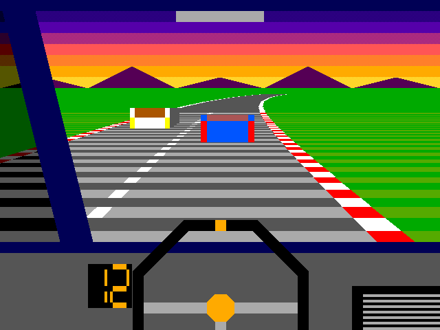
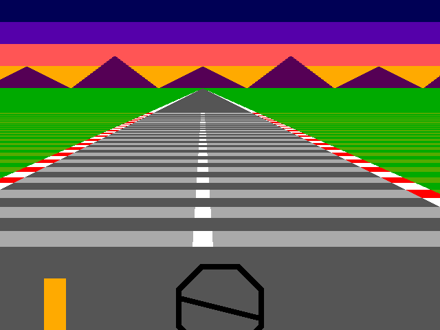
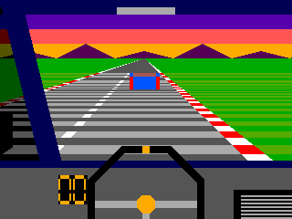
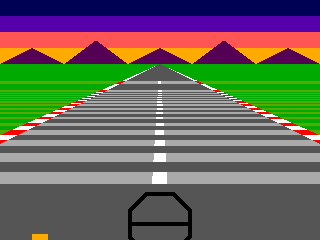

  

# First Person Driving Game

A first-person pseudo-3D driving game drawn straight to a VGA monitor, with engine sound, built for the GlobalFoundries 180 nm process through [Tiny Tapeout](https://tinytapeout.com) as an entry to the Vulkos Unichip competition.

There is no framebuffer and no stored images. Every pixel's colour is calculated as the screen is scanned, at 640x480 and 60 Hz from a 25 MHz clock.

## Two versions

This repository holds two complete versions of the game, each on its own branch.

| | **1x2 version** | **1x1 version** |
|---|---|---|
| Branch | [`main`](https://github.com/Yamin-D/tt-first-person-driving-game) | [`1x1-version`](https://github.com/Yamin-D/tt-first-person-driving-game/tree/1x1-version) |
| Screen |  |  |
| Driving |  |  |
| Road | Curves on a 16-segment looping track | Straight, with steering and speed |
| Traffic | A slow car to overtake, an oncoming car to avoid, crashes and a score | None |
| Cockpit | Roof, left pillar, side window, mirror, dashboard with console, large wheel | Dashboard, small wheel, speed bar |
| Scene | Sunset with a checkerboard between its bands, mountains | Sunset, mountains |
| Sound | Engine with speed-dependent pitch and a rough edge, gravel noise | The same |

The clips above are rendered from the bit-exact Python model of each design, so they show what the chip draws.

## How it works

**Racing the beam.** A flat road seen from height H with focal length f has the simple property that the screen row s_y below the horizon shows the road at distance z = fH / s_y. That is the only division in the design. A small serial divider produces one quotient bit per clock during horizontal blanking, ready for the next line. Everything else is linear in s_y, so the road's half-width is just twice s_y, a shift, and the road centre is built by adding the car's position once per line. The pixel logic is then a single adder and a few comparisons.

**Driving.** Once per frame, speed, wheel angle, heading and position are updated with shifts and small adders, spread over a few clocks so that each clock does one addition.

**Curves (1x2).** A road bending with curvature k has a sideways offset of k z² / 2 at distance z, so after perspective the offset on screen is proportional to z. The divider already produces z, so each line's offset is up to three shifted additions in horizontal blanking, and the per-pixel path stays a single adder. Curvature follows a track table and eases in with distance.

**Traffic (1x2).** Each car has a depth. Scanning down the screen, the last row whose depth reaches a car's depth is its base. Its position and size are stored at that row and the next frame draws the car from them, so it stands upright with a single width for all its rows, rather than following the road's perspective. Hitting a car stops you for about a second and resets the score.

**Steering wheel.** The wheel has only five angles, so no trigonometry is needed. The rim is the gap between two octagons tested from |dx|, |dy| and |dx| + |dy|, and the spokes are sheared with a slope of wheel/4, which is a shift.

**Sound.** A phase accumulator steps once per line, with a step that rises with speed, giving about 61 Hz at idle and 488 Hz flat out. A sawtooth and a square an octave below are mixed, with a little noise on part of each cycle, and output as PWM.

The [datasheet](docs/info.md) has more detail.

## Design process

The design was built up in stages, and each feature was checked against the same process.

1. **A bit-exact model first.** `dev/model/road_model.py` is the specification: every quantity is an integer with the same width and update order as the hardware. New features were designed and previewed there before any Verilog was written.
2. **RTL to match.** The Verilog in `dev/rtl` is one module per file and is combined into the single `src/project.v` that Tiny Tapeout builds.
3. **Tests against the model.** Unit tests check the divider on every road row, the car state over thousands of frames, the curve logic for every curvature against extreme positions, and the audio sample by sample. A whole-chip Verilator test then reads complete frames back from the VGA pins and compares them to the model pixel by pixel, covering every wheel angle, the tightest bends, overtakes and crashes. A gate-level simulation compares the GF180 netlist against the RTL over 900,000 clocks.
4. **Measured on real cells.** Area was measured with Yosys on the GF180 standard cells after each change, and timing from the real place-and-route results, at the slowest corner of 125 °C and 3.0 V.

Fitting the design to the tile drove many of the decisions:

- Region boundaries on screen were chosen so that most tests are bit slices of the row and column counters.
- Multiplying by a power of two is only wiring on a chip like this. Widening the road by 1.5x needed adders throughout, while 2x was free, and using 2x saved about 4,900 µm².
- Long per-pixel paths were split into pipeline stages, and signals with very high fan-out were given local copies. Synthesis merges identical copies, so the copies had to be made different.
- Features were weighed against each other for area: the speed bar on the 1x2 version was removed to make room for the rest.

## Results

From the Tiny Tapeout layout builds on GF180 at 25 MHz:

| | 1x2 version | 1x1 version |
|---|---|---|
| Cell area before place and route | 80,384 µm² | 34,162 µm² |
| Core utilisation | 84.6% | 83.9% |
| Worst setup slack, slow corner | +3.07 ns | +6.04 ns |
| Setup and hold violations | 0 | 0 |
| DRC, LVS and antenna errors | 0 | 0 |

## Playing it

Connect a VGA monitor through a Tiny VGA PMOD on the output pins, and an amplified speaker through an RC low-pass filter on `uio[0]`. Clock the chip at 25 MHz.

| Input | Control |
|---|---|
| `ui[0]` | Steer left |
| `ui[1]` | Steer right |
| `ui[2]` | Accelerate |
| `ui[3]` | Brake |

## About Tiny Tapeout

[Tiny Tapeout](https://tinytapeout.com) is an educational project that makes it easier and cheaper to get digital designs manufactured on a real chip.
